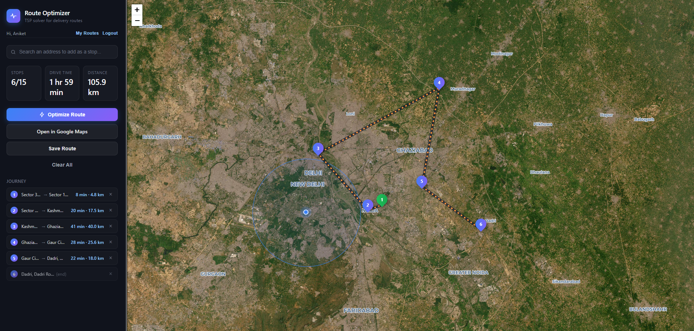
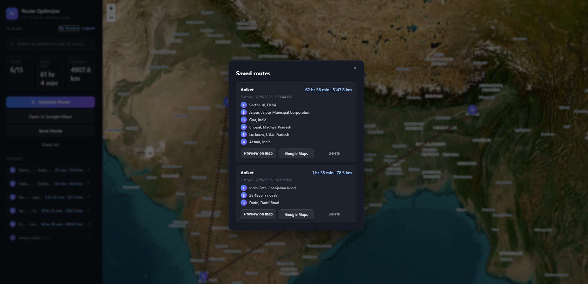

# Logistics Route Optimizer

Drop delivery stops on a map and get back the fastest order to visit them — solves a Traveling
Salesman Problem using real driving data (OSRM) and Google's OR-Tools optimizer, drawn on a live
satellite map.



## Features

- **Real driving data, not straight-line guesses** — every distance/time comes from OSRM's road
  network, so the optimizer accounts for actual roads, one-ways, and highways.
- **Address search** — type an address instead of hunting for it on the map (typo-tolerant, powered
  by Photon/OSM).
- **Draggable pins** — reposition a stop directly on the map, no re-searching needed.
- **Leg-by-leg breakdown** — see drive time and distance for each hop in the route, not just the total.
- **One-click handoff to Google Maps** for real turn-by-turn navigation.
- **Accounts + saved route history** — log in to save routes, preview them back on the map later, or
  delete ones you don't need.
- **Guest-friendly** — optimizing a route works without an account; login is only required to save one.



## How it's put together

- **frontend/** — React + Vite + Leaflet. Search or click the map to add stops, hit optimize, watch
  the route draw.
- **backend/** — Node/Express. Pulls a driving-time/distance matrix from OSRM, hands it to the
  solver, handles auth, and persists routes to MongoDB Atlas.
- **solver-service/** — Python FastAPI service wrapping OR-Tools. Takes a duration matrix, returns
  the optimal visiting order. Runs as its own HTTP service, completely decoupled from Node.

```
Frontend -> Backend -> OSRM (driving times/distances) -> solver-service (OR-Tools) -> back to Frontend
                     -> MongoDB Atlas (users + saved routes)
```

**Stack:** React, Vite, Leaflet, Node.js, Express, MongoDB (Atlas), Mongoose, JWT auth, Python,
FastAPI, Google OR-Tools, OSRM, Photon/OpenStreetMap geocoding.

## Running it locally

You need 3 terminals open — solver-service and backend both need to be up before the frontend's
optimize button will work.

### 1. solver-service (Python)

```
cd solver-service
python -m venv venv
venv\Scripts\activate      # windows
pip install -r requirements.txt
uvicorn main:app --reload --port 8000
```

Check it's alive: http://localhost:8000/docs

### 2. backend (Node)

```
cd backend
npm install
copy .env.example .env
```

Open `.env` and fill in `MONGO_URI` (from MongoDB Atlas) and `JWT_SECRET` (any random string — the
`.env.example` file has a one-liner to generate one). Then:

```
npm run dev
```

Check it's alive: http://localhost:5000/health

### 3. frontend (React)

```
cd frontend
npm install
npm run dev
```

Open whatever URL Vite prints (usually http://localhost:5173).

## Using it

1. Search an address or click the map to drop a stop (up to 15).
2. Hit **Optimize Route** — backend fetches real drive times/distances between every stop from
   OSRM, sends them to the solver, and draws the fastest path back with a leg-by-leg breakdown.
3. Drag any pin to reposition it, or remove one — the route flags itself as stale until you
   re-optimize.
4. **Open in Google Maps** for turn-by-turn navigation, or **Save Route** (requires login) to keep
   it in your history.

## Known limitations

- **Single depot, one vehicle** — this solves classic TSP (one driver, N stops), not a full
  multi-vehicle VRP with time windows or capacity constraints.
- **Public OSRM server** — `router.project-osrm.org` is free and requires no signup, but it's
  rate-limited and not meant for production traffic. Swap `OSRM_BASE_URL` in `backend/.env` for a
  self-hosted OSRM instance if you need reliability at scale.
- **Browser geolocation accuracy varies** — desktop browsers without GPS estimate location from
  WiFi/IP data, which can be off by anywhere from meters to kilometers depending on the network.
